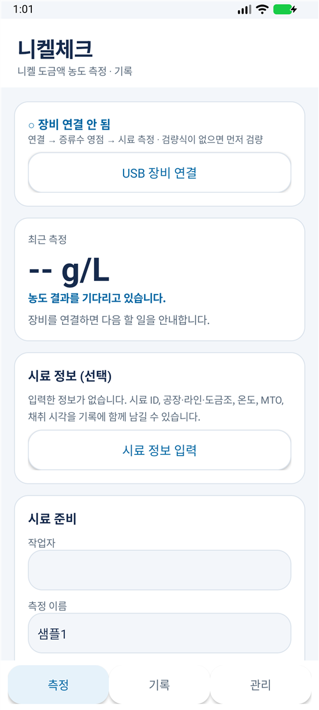
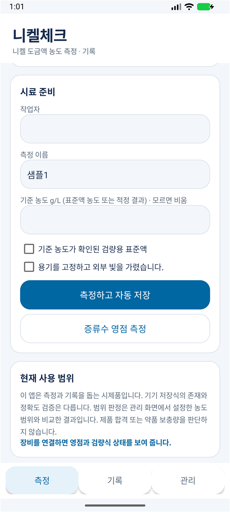
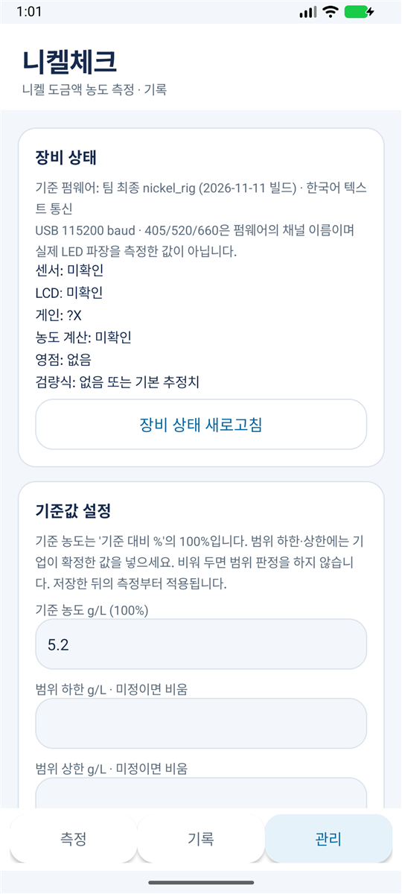

# 니켈체크 (NiCheck)

안드로이드 휴대폰에 측정기를 USB로 연결해 니켈 도금액 농도를 재고 기록하는 앱입니다. 현장에서 PC 없이 휴대폰만으로 농도를 확인하는 것이 목적입니다.

> **시제품입니다.** 화면의 농도는 측정기에 저장된 검량식으로 계산한 값입니다. 측정 정확도와 현장 적용은 따로 검증해야 하며, 이 앱은 제품 합격 여부나 약품 보충량을 판단하지 않습니다.

<p>
  
  
  
</p>

왼쪽부터 측정 화면, 시료 준비와 측정 버튼, 관리 화면입니다. 측정기를 연결하기 전의 모습입니다.

## 내려받기

**[최신 APK 내려받기](https://github.com/parkmse/nicheck-android/releases/latest)** · [사용 설명서](docs/UserGuide_KO.md)

받은 APK 파일을 휴대폰에서 눌러 설치합니다. "출처를 알 수 없는 앱 설치"를 허용해야 합니다.

## 쓰는 순서

1. 측정기를 USB 케이블로 휴대폰에 꽂고 **USB 장비 연결**을 누릅니다.
2. 증류수 큐벳을 넣고 **증류수 영점 측정**을 누릅니다.
3. 시료 큐벳으로 바꾸고 **측정하고 자동 저장**을 누릅니다.
4. 농도(g/L)와 기준 대비 %가 표시되고, 기록이 자동으로 저장됩니다.

검량, 기준값 설정, 안내 문구별 대처는 [사용 설명서](docs/UserGuide_KO.md)에 있습니다.

## 필요한 것

| 준비물 | 조건 |
|---|---|
| 휴대폰 | 안드로이드 8.0 이상, USB 기기 연결(USB 호스트) 지원 |
| 측정기 | ESP32 + AS7341, 한국어 텍스트 통신을 쓰는 `nickel_rig` 펌웨어 |
| 케이블 | 데이터용 USB 케이블. 단자가 맞지 않으면 OTG 어댑터 |

- 아이폰은 지원하지 않습니다. 아이폰 앱은 USB로 측정기와 통신할 수 없습니다.
- JSON 통신을 쓰는 이전 펌웨어(v04)가 들어 있는 측정기는 연결되지 않고 안내 창이 뜹니다.

## 기능

- **농도와 기준 대비 %**: 기준 농도는 관리 화면에서 바꿉니다(기본 5.2 g/L).
- **범위 판정**: 하한·상한을 넣었을 때만 정상 / 낮음 / 높음을 표시합니다.
- **시료 정보 기록**: 시료 ID, 공장, 라인, 도금조, 시료 온도, MTO, 채취 시각, 적정 결과를 함께 남길 수 있습니다.
- **기록과 CSV**: 측정할 때마다 자동으로 저장하고, 전체 기록을 CSV 파일로 내보냅니다.
- **검량**: 측정기에 저장된 검량식을 그대로 씁니다. 앱에서 표준액 3종 이상을 각각 3회 이상 재서 새로 검량할 수도 있습니다.
- **결과 보류**: 센서 포화, 신호 부족, 영점이나 검량식 없음, 검량 범위 밖 같은 경우에는 농도 대신 이유를 보여 줍니다.
- **기록 보관**: 기록은 휴대폰 안에만 저장합니다. 앱에 인터넷 권한이 없습니다.

## 확인된 범위

확인한 것:

- 응답 해석과 계산에 대한 단위 점검 44개
- 에뮬레이터 설치·실행(0.2.0)
- 실제 안드로이드 휴대폰과 브레드보드 측정기에서 연결·측정(같은 코드의 시험용 빌드)

아직 확인하지 않은 것:

- 농도 정확도와 현장 효과
- 0.2.0 배포용 파일을 실제 기기에서 돌려 보는 것
- 이전 배포 펌웨어(A660 − A520 계산)와의 실제 연결

앱에는 검량식이 들어 있지 않습니다. 측정기마다 표준액으로 검량해야 농도가 표시됩니다.

## 직접 빌드하기

Android Studio에서 이 폴더를 엽니다. 폴더 경로에 한글이 있으면 빌드 도구가 리소스를 열지 못하므로, 한글이 없는 경로에 두고 엽니다.

명령줄(Windows)에서는 다음과 같이 빌드합니다.

```
set JAVA_HOME=C:\Program Files\Android\Android Studio\jbr
set ANDROID_HOME=%LOCALAPPDATA%\Android\Sdk
gradlew.bat assembleDebug testDebugUnitTest
```

- 빌드 환경: Gradle 9.6.1, Android Gradle 플러그인 9.5.1, compileSdk 37, minSdk 26, Java 11
- 배포용으로 서명해 빌드하는 방법은 [개발 기록](docs/DevLog_KO.md)의 "배포용 빌드 준비"에 있습니다. 서명키는 저장소에 들어 있지 않습니다.

## 폴더 구성

| 경로 | 내용 |
|---|---|
| `app/` | 앱. 화면 `MainActivity`, 응답 해석·계산 `MeasurementCore`, USB 연결 `UsbInstrument` |
| `app/src/test/` | 단위 점검 `CoreTest` |
| `usbserial/` | usb-serial-for-android v3.10.0 소스(MIT 라이선스). 출처는 `PROVENANCE.json` |
| `docs/` | 사용 설명서, 통신 형식, 개발 기록, 화면 사진 |

## 문서

- [사용 설명서](docs/UserGuide_KO.md): 설치, 측정 순서, 검량, 안내 문구별 대처
- [측정기 통신 형식](docs/FirmwareProtocol_KO.md): 앱과 펌웨어가 주고받는 명령과 응답
- [개발 기록](docs/DevLog_KO.md): 날짜순 작업 내용과 확인 결과

## 남은 일

- 반복 측정 평균, 영점 후 경과 시간 안내, 게인 자동 맞춤
- 저장된 기록에 적정 결과를 나중에 추가하는 기능
- 0.2.0 배포용을 실제 휴대폰과 측정기에서 확인
- 아이폰 지원. USB로는 불가능해서 Wi-Fi나 블루투스 방식으로 바꿔야 하고, 펌웨어도 함께 고쳐야 합니다
- 쓰이지 않는 `app/src/main/assets/release_profile.json` 정리
